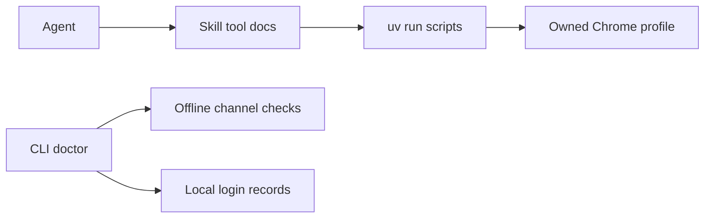

# web-skill

On-device tools for Claude Code: video transcripts, social page reads, and
personalized video recommendations. The agent reads the bundled tool docs and
uses standalone `uv run` scripts; the Python CLI installs video dependencies,
registers the skill and reports offline availability.

## Install and rebuild

```bash
uv tool install git+https://github.com/ophis/web-skill.git
web-skill install
web-skill skill --install
web-skill doctor
```

After changing this checkout, rebuild the CLI **before** copying its bundled skill:

```bash
uv tool install . --force
web-skill skill --install
```

For an installed release, refresh both with:

```bash
uv tool install git+https://github.com/ophis/web-skill.git --force
web-skill skill --install
```

See [INSTALL.md](INSTALL.md) for first-run setup.

## Tools

| Tool | Behavior |
| --- | --- |
| video-transcript | YouTube / Bilibili / video URL / local audio transcription |
| xiaohongshu | Read visible notes, search pages and comments using independent Chrome |
| reddit | Read visible posts, comments, subreddits and search pages |
| twitter | Read visible X tweets, timelines and search pages |
| recommend | YouTube / Bilibili personalized video candidates from independent login |
| web | Read an http(s) page: title, final URL, text; optional CSS selector and links |

```bash
web-skill read https://example.com --links
web-skill login https://x.com/
```

Only the user logs in, manually, in the visible window. Browser reads use installed
Google Chrome through Playwright, with no browser download or new global Python
dependency. See [web.md](web_skill/skill/tools/web.md) for profile ownership,
read-only limits and all options. Social output is limited to rendered content;
blocked requests or login walls can prevent a site from rendering fully.

`doctor` starts no browser and runs no social authentication command. Its login
records are local user confirmations, **not verified sessions**; they may be stale.

## Architecture



| Location | Responsibility |
| --- | --- |
| `web_skill/cli.py` | install, doctor, skill, read, login |
| `web_skill/channels/` | platform routing and backend availability |
| `web_skill/probe.py` | process-group-bounded command probes |
| `web_skill/skill/tools/` | agent routing docs |
| `web_skill/skill/scripts/` | standalone scripts with inline dependencies |
| `tests/` | fake-only unit tests |

## Development

Follow [CLAUDE.md](CLAUDE.md). Full unit suite:

```bash
uv run --with pytest --with requests pytest tests/
```

## Requirements

macOS / Apple Silicon for MLX transcription; Homebrew for existing video tools.
Web reads require `uv` and an installed Google Chrome.
